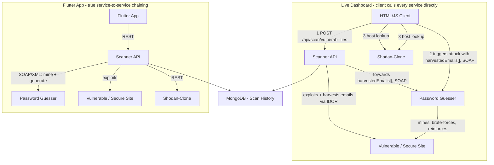

# 🛡️ Security Vulnerability Scanner

A hands-on, full-stack security lab: a deliberately vulnerable web app, a hardened twin, and an automated scanner that attacks both — built as one interconnected system spanning **3 languages, 6 microservices, and 5 computer science disciplines** (Security, SOA, Machine Learning, Data Mining, Cloud/DevOps).

Not a tutorial clone. Every vulnerability here is self-built, self-exploited, and self-fixed — then proven side-by-side against its secure counterpart.

---

## 🎯 What it does

Point the scanner at a target URL and it will:
1. **Mine** real words straight from the target site's own content (Data Mining)
2. Feed those words into a **custom-trained ML model** to generate realistic password guesses
3. Run live **SQL Injection** and **XSS** attacks against login/comment forms
4. Query a **Shodan-style recon service** for host/port intel
5. Store and report the full findings — and prove the exact same attacks fail against the hardened version

## 🏗️ Architecture



The moment Scanner harvests account emails via the IDOR exploit, it forwards them directly to Password Guesser over SOAP — a genuine service-to-service call, with no browser involved — purely to log the handoff. The client independently triggers the real mine → mangle → generate → brute-force → reinforce attack when the second button is pressed, using the same harvested emails returned to it in Scanner's response.

## ⚔️ Vulnerable vs. Secure, side by side

| Vulnerability | Vulnerable site | Secure site |
|---|---|---|
| **SQL Injection** | Raw string-concatenated queries — `' OR '1'='1' #` bypasses login | Parameterized queries (`WHERE email = ?`) |
| **XSS** | Comments rendered unescaped — stored `<script>` executes for every viewer | Auto-escaped output |
| **IDOR** | `/account?id=X` — checks the resource *exists*, not that it belongs to you | Ownership check against the session before returning any data |
| **Password storage** | Plaintext comparison | bcrypt hash + compare |

## 🧰 Tech stack

| Layer | Stack |
|---|---|
| Vulnerable / Secure sites | Node.js, Express, EJS, MySQL |
| Scanner (orchestrator) | Node.js, Express, MongoDB |
| Password Guesser | Python, Flask, **SOAP/XML** (not REST), custom n-gram ML model |
| Recon Service | Java, Spring Boot |
| Mobile client | Flutter |
| Infra | Docker, Docker Compose |

## 💡 What I learned building this

- **SOA**: the real difference between REST and SOAP, and why service-to-service chaining is harder (and more realistic) than isolated APIs
- **Data Mining**: turning unstructured web text into a ranked, usable word list (tokenization, stopword filtering, frequency analysis) — and feeding that straight into an ML pipeline
- **Security**: the difference between checking a resource *exists* vs. checking it *belongs to the requester* (IDOR) — and how attackers find these via sequential ID enumeration in logs
- **DevOps**: diagnosing a silent Spring Boot 4 config bug by extracting a running container's compiled JAR and reading the library's own configuration metadata, rather than guessing
- **Docker networking**: why `localhost` inside a container isn't what you think it is

## 🚀 Running it locally

```bash
git clone https://github.com/ghassen1586-ui/security-scanner-project.git
cd security-scanner-project
docker compose up --build
```

Then open `client/index.html` in your browser, or point the Flutter app / Postman at `http://localhost:3002/api/scan`.

## ⚠️ Disclaimer

Built for educational purposes as a university project. The vulnerable site is intentionally insecure — do not deploy it anywhere public.